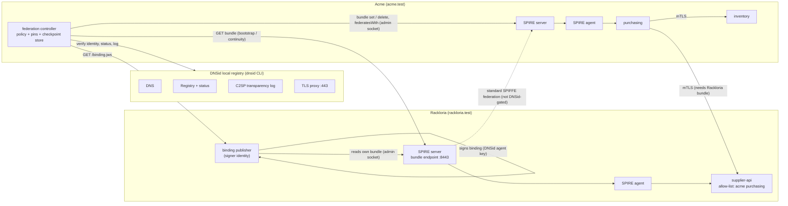
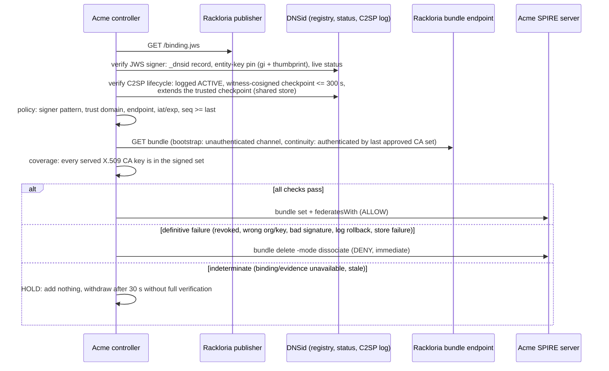

# Recipe 16 — Architecture

Three layers, kept separate in the code and in every result the recipe prints:

| Layer | Question it answers | Here |
|---|---|---|
| **DNSid** | Which organization is behind this trust domain, and is its federation signer still active? | Acme's federation controller verifies Rackloria's signed binding, governance pin, and C2SP lifecycle evidence |
| **SPIFFE** | Is this workload who it claims to be? | SPIRE issues X.509-SVIDs; mTLS handshakes verify them against the trust bundles each side holds |
| **Application authorization** | May this workload call this API? | Each API's own allow-list of SPIFFE IDs (HTTP 403 otherwise) |

DNSid never sees workload traffic. It decides only whether Acme's SPIRE holds Rackloria's bundle at all.

## Components



## The binding

A compact JWS signed with the federation signer's DNSid operational key. Its payload:

```json
{"typ": "dnsid-spiffe-federation+v0", "iss": "<signer fqdn>", "trust_domain": "rackloria.test",
 "bundle_endpoint": {"url": "https://rackloria-server:8443", "spiffe_id": "spiffe://rackloria.test/spire/server"},
 "x509_authorities_spki_sha256": ["<b64url>", "..."], "seq": 1793000000, "iat": 1793000000, "exp": 1793000900}
```

The format is specific to this recipe: the DNSid draft defines no binding for external key material.

## One reconcile cycle



Design rules:

- **Fresh lifecycle, persistent checkpoints.** Each cycle builds a new `IdentityManager` and log registry (`status_check_interval=0`), so status and history are never cached. One durable `CheckpointStore` is injected into every registry, so rollback and fork protection survives cycles and restarts.
- **Fail closed.** Every exception path ends in DENY or HOLD, never ALLOW. HOLD is bounded by the grace period.
- **Bootstrap vs continuity.** The first bundle fetch is over an unauthenticated channel, but the material is accepted only if every served CA key is covered by the DNSid-signed SPKI set. After the first approval, fetches must be authenticated by the previously approved CA set. Only an explicit admin re-bootstrap (`POST /rebootstrap`, which withdraws the bundle and is audited as `ADMIN_REBOOTSTRAP`) returns to the unauthenticated path.
- **Coverage, not equality.** Signed-but-not-yet-served keys are allowed (a CA rotation is pre-announced). Served-but-unsigned keys are never installed. JWT authorities are never installed.

## Trusted checkpoint store

`src/dnsidfed/checkpoints.py` wraps the SDK's `InMemoryCheckpointStore` with persistence:

| Situation | Behavior |
|---|---|
| First install | `make bootstrap` runs `python -m dnsidfed.checkpoints ensure-initialized`, which initializes the store only when it has never existed; the journal records `initialized` |
| Controller restart | The same file is loaded; history is not reset |
| File missing at start, journal shows initialization | Fail closed (loss, not first start); `init` refuses |
| File missing or changed while running | Fail closed; never written back as a new baseline |
| File corrupt, second writer, write failure | Fail closed |
| Recovery | `reset --confirm-new-baseline --reason …` with the controller stopped; the old file is archived and the reset journaled |

Fail closed means the store raises `C2spCheckpointStoreError`. The SDK reports it as a non-transient `LOG_ERROR`, and the controller maps it to `DENY CHECKPOINT_STORE_FAILED` and withdraws.

**Limits.** Anyone who can write the controller's state directory can remove both the store and its journal (indistinguishable from a fresh install), or substitute an older copy while the controller is stopped. Protect that directory like the policy and pins. Keep the journal on append-only or off-host storage where that matters. After `init` or `reset`, the first checkpoint per log origin is trusted on first use.

## Revocation and established connections

Revoking the federation signer causes the next cycle to DENY. The trigger is the identity's status, its JWKS answering 410, or the log showing the revocation. Any one is enough. In the live run the live status came first, then the JWKS 410; the local log recorded the revocation about a minute later. Because the cycle stops at the first failure, the trusted checkpoint store does not advance on a revocation. The controller deletes the bundle, and the SPIRE agent removes it from Acme's workloads, so new handshakes to Rackloria fail. TLS sessions established earlier are not re-authenticated. Acme verified Rackloria's certificate once, at handshake time. Those sessions keep carrying requests, and the supplier keeps authorizing each request against the client identity presented at handshake, until the application closes them.

## Operational limits

**Orderly shutdown withdraws only trust the controller can prove it installed.** On SIGTERM or SIGINT (`docker stop`, `make stop`) the controller does the following:

1. It finishes the cycle in progress.
2. Under its reconciliation lock, it refuses any further cycle.
3. It checks ownership: the controller persists the exact X.509 authority set it last installed (`managed_spki` in `state.json`), and ownership is established only if SPIRE's current `rackloria.test` bundle matches that record exactly.
4. If ownership holds:
   - The policy's own federated entries stop federating with `rackloria.test`. Any other federations on those entries are kept.
   - The bundle is deleted in SPIRE's `restrict` mode. That mode refuses while any *other* entry still federates with the trust domain, so relationships the controller does not manage are never cut. In that case the event is `DISSOCIATED` and the bundle stays. If the delete fails for any other reason (for example a CLI timeout), the managed entries no longer federate but the bundle may remain: the event is `DISSOCIATED` with reason `CONTROLLER_SHUTDOWN_INCOMPLETE`, and the exit status is 3.
5. If ownership cannot be established, nothing changes. Reasons include: no record, a bundle that differs from the record, or SPIRE that cannot be read. The event is `CONTROLLER_SHUTDOWN_OWNERSHIP_UNCERTAIN` and the exit status is 3.

Every outcome writes a shutdown audit event (`CONTROLLER_SHUTDOWN`, `CONTROLLER_SHUTDOWN_OWNERSHIP_UNCERTAIN` or `CONTROLLER_SHUTDOWN_INCOMPLETE`); an unexpected error names the step that failed. The checkpoint store is closed even if shutdown fails. Trust anchors (for authenticated continuity), the anti-rollback sequence and the checkpoint history are kept. Shutdown makes up to four `spire-server` calls for this recipe's one federated entry, each with a 20 s timeout, after any cycle in progress; Compose allows 120 s (`stop_grace_period`), which is room for a slow SPIRE, not a guaranteed bound.

**Abrupt failures withdraw nothing.** A crash, SIGKILL, OOM kill, Docker daemon failure or host failure runs no shutdown code: the last installed bundle stays in SPIRE. When the controller runs again, its first cycle re-verifies. A definitive failure withdraws at once. An indeterminate one withdraws once the time since the last full verification exceeds the 30 s grace, which a long outage already has. Until then, the exposure window is the downtime plus one cycle. A controller that cannot start at all, for example because its policy no longer loads, enforces nothing. Monitor `GET /healthz` (503 when cycles stall) and the container state from outside.

**Stopping and cleaning.**
- `make stop` stops the publisher first, so nothing new can be approved. It then stops the controller while SPIRE is still up, so the orderly shutdown above can run. Then it stops the rest and the recipe's local registry. Volumes, the local registry state, pins, policy, identities, the checkpoint store, its journal and the audit log are all kept. `make bootstrap` resumes from them:
  - the checkpoint store is reused, never re-initialized;
  - a pinned entity key the local registry no longer serves stops bootstrap instead of being re-pinned;
  - the federation signer is reused only after the registry positively reports it ACTIVE. A revoked, retired, missing or unverifiable signer stops bootstrap; uncertainty (a timeout, a connection error) is never treated as absence, so it can never cause a replacement. A new signer is issued only on a first install with no earlier signer, pin, checkpoint store or registry signer;
  - the published `_dnsid` record is read only from this recipe's own resolver: the port in `.dnsid-local/config.yml`, confirmed against the running DNS container of this instance and a health query. The CLI's `DNSID_DNS_SERVER` is compared and reported, never used (see README, "What goes wrong");
  - SPIRE registration entries are created only when their absence is confirmed; an existing entry is accepted only if its SPIFFE ID, parent, selectors, federation relationships and other constraints match exactly, and is never overwritten or deleted.
- `make clean` lists exactly what it removes: this recipe's Compose project, its own local registry instance, `.dnsid-local/` and `.state/`. It refuses to delete checkpoint history without `CONFIRM=delete-checkpoint-history`, and archives that history and the audit log to `.archive/checkpoints-<utc>/` (SHA-256 verified, with a manifest) before removing anything. A local registry reset starts a new transparency log, so the old history cannot be kept in place.
- Every operation is confined to the recipe:
  - The state directory must be exactly `<recipe>/.dnsid-local`, by its canonical path and not through a symlink. The Makefile refuses any `STATE` override and must be run from its own directory.
  - Compose uses this checkout's own project, `dnsid-recipe16-<hash of the canonical recipe path>` (`scripts/paths.py`), for containers, volumes, networks and image tags. An explicit, validated `RECIPE16_COMPOSE_PROJECT` selects another name: never another checkout's derived name, and a custom name only with `RECIPE16_ALLOW_CUSTOM_PROJECT=<the same name>`. Every target that touches Docker first checks ownership (`paths.py check-owner`). All containers of the project, running or stopped, must carry this checkout's working-dir label; a missing label or a failed Docker query refuses. Volumes or networks left without containers are accepted only for this checkout's own derived name. The legacy shared project `dnsid-recipe16` is used only when named explicitly: bootstrap refuses to start while it is running, and cleanup refuses it without `CONFIRM_LEGACY_PROJECT=dnsid-recipe16`.
  - `identity.py` writes only inside `.state/dnsid/`.

## Validation status

Each run below tested a revision of this recipe from the review of pull request #165, whose commits were later squashed into one; each run's test count and timings belong to that run. Timings are observations from individual runs, not performance bounds: they depend on the poll interval, the registry and how fast the SPIRE agent delivers changes.

- **Offline unit tests** (`make test`, no Docker and no external network; 690 tests in this version, run on Python 3.11, 3.13 and 3.14, from the recipe directory and through `make -C`): binding validation, governance and entity-key pinning, SPKI coverage, lifecycle and evidence handling, structured SDK error mapping, fail-closed reconcile decisions, checkpoint store persistence, loss and tampering detection and audited reset, and orderly shutdown. Restart safety is covered too: resolver isolation from the CLI's `DNSID_DNS_SERVER`, signer preservation (an uncertain status never issues a replacement), named bootstrap failure categories, verified-idempotent SPIRE registrations (including a re-run after the controller has federated purchasing with `rackloria.test`), recreating a stopped controller whose DNSid Local network was recreated, and per-checkout Compose isolation with ownership checks. The bundle endpoint's continuity checks run through the real `fetch_bundle` against a TLS server on 127.0.0.1: a trusted CA with the expected URI SAN is accepted; an untrusted CA, or a wrong or missing URI SAN, is rejected; the client sets an explicit TLS 1.2 minimum and negotiates TLS 1.3 and TLS 1.2. Consistency tests keep the SPIRE image pins on one release (one identical `spire-server` image for the controller CLI and the server). The shell paths run in bash 3.2 against stubbed `docker`. The SDK's own store enforces the fork rule in these tests.
- **Live run, 2026-11-19/20 (development checkout on macOS, Docker Desktop, not a clean clone).** All three acts were driven step by step, following `verify/verify.sh`. A `make stop` / `make bootstrap` resume was exercised before Act 2.
  - Act 1: Acme's internal mTLS worked. Purchasing's handshake to the supplier failed at the SPIFFE layer, with no `rackloria.test` bundle in Acme's SPIRE. The controller held (`HOLD BINDING_UNAVAILABLE`).
  - Act 2: about 3 s after the binding was signed, the controller's own cycle decided `ALLOW INSTALLED`.
    - Evidence: `dnsid_result: VERIFIED`; signer matching the policy pattern; governance `rackloria.test`; the pinned entity key; live status ACTIVE; logged state ACTIVE; a witness-cosigned checkpoint 0.2 s old.
    - The checkpoint was persisted to the durable store. The installed bundle's CA key matched Rackloria's actual CA key and the signed set.
    - Separately from the controller, the binding's Ed25519 signature was verified against the signer's published JWKS.
    - A new cross-domain handshake succeeded, and the supplier's own allow-list admitted `spiffe://acme.test/purchasing`.
  - Act 3: the signer was revoked, and the controller's own cycle decided `DENY WITHDRAWN IDENTITY_NOT_ACTIVE`.
    - Timings from the revoke call: registry REVOKED +0.19 s; DENY +3.9 s; bundle absent +4.4 s; first failing new handshake +8.3 s. The gap is the SPIRE agent delivering the change.
    - The trigger was live status (`STATUS_NOT_ACTIVE`); later cycles failed on the JWKS 410. The C2SP log recorded the revocation about 60 s later, so the withdrawal did not depend on the log.
    - The Act 2 connection stayed established, kept returning HTTP 200, and the supplier kept authorizing each request. After it was closed, reconnecting failed at the SPIFFE layer. Internal mTLS was unaffected throughout.
- **Clean clone, 2026-11-20 (an earlier revision, before the review corrections; macOS on Apple silicon, Docker Desktop, `linux/amd64` images under emulation, `dnsid` CLI `2026.10.29-537b773`).** A fresh checkout ran as its own Compose project and local registry instance, with a new signer, pin and checkpoint store each time:
  - `make bootstrap` (51 s, with images largely from the build cache), then `make verify`: 646 offline tests and every live check passed (44 s).
  - `make clean CONFIRM=delete-checkpoint-history`, then `make run`, a new first install: every check passed (64 s).
  - A final `make clean` removed only that checkout's containers, volumes, networks, local registry and state, and kept the archives. The development stack and its volumes were untouched.
  - In both runs the controller decided `DENY WITHDRAWN IDENTITY_NOT_ACTIVE` 3.5 s after revocation, triggered by live status.
- **Live checkpoint rollback, 2026-11-20 (the same earlier revision, disposable checkout).**
  - The controller allowed, then accepted a newer checkpoint (size 2) after the log grew.
  - The disposable local registry was then restored to its older log state, and served the validly signed size-1 checkpoint.
  - On its first cycle afterwards the controller recorded `DENY WITHDRAWN LOG_INCONSISTENT` (`C2SP checkpoint tree size regressed (1 < trusted 2): rollback or fork`). Every later cycle was the same, and it never re-allowed.
  - The trusted store kept size 2 with the same root. The bundle was withdrawn, new cross-domain handshakes failed at the SPIFFE layer, and internal mTLS kept working. The signer stayed ACTIVE throughout, so the denial was the rollback, not a revocation.
  - This exercised the SDK's tree-size regression check.
- **Live validation, 2026-11-23 (the revision with the first round of review corrections; disposable checkout, same platform and CLI as above).** Two phases, each a new first install with its own signer, cleaned up afterwards with only that checkout's resources removed:
  - `make verify`: 686 offline tests and every live check passed, with all four images built and run under their `:dev` tags. `make clean` without `CONFIRM` refused and listed only that checkout's resources.
  - Bootstrap re-run during active federation: after the controller's `ALLOW INSTALLED`, purchasing's entry federated with `rackloria.test`. A second `make bootstrap` accepted it (`existing registration verified`, nothing created), reused the ACTIVE signer and the preserved checkpoint store, and left the controller running. Snapshots before and after showed the registration entries (IDs, revisions, every field), the installed `rackloria.test` bundle, the controller's ownership record and every container's start time unchanged; the checkpoint journal was unchanged (no reset).
  - Continuity: every controller cycle across the re-run (9) was `ALLOW UNCHANGED` in `continuity` mode, so the bundle endpoint was authenticated by the previously approved CA set against SPIRE's real endpoint.
  - Revocation: the controller decided `DENY WITHDRAWN IDENTITY_NOT_ACTIVE` (3.5 s after the revoke call in this run). The bundle was withdrawn, purchasing's entry no longer federated with `rackloria.test`, new cross-domain handshakes failed at the SPIFFE layer, and internal mTLS kept working.
- **Linux CI, 2026-11-23 (the pre-squash review branch of pull request #165, from the revision with the GNU Make and TLS fixes onward; GitHub Actions Ubuntu runner, `make -C recipes/16-spiffe-federation verify`).** 690 offline tests passed, then the full live flow on Linux: bootstrap, and every check of Acts 1-3 (26), from `ALLOW INSTALLED` with its DNSid and C2SP evidence to `DENY WITHDRAWN IDENTITY_NOT_ACTIVE` after revocation and the established-connection observations.
- **Not yet demonstrated:**
  - A fork (same tree size, different root) or a log that grows inconsistently with the trusted one, served by a live log. The SDK's prefix-root recomputation for those cases is covered only by the offline tests.
  - Re-attesting a SPIRE agent that lost its credentials, through `make bootstrap`.
  - A bundle endpoint failing continuity live (an untrusted CA, or an incorrect SPIFFE URI SAN). Successful live `continuity` fetches are recorded above; the rejection paths are covered by the loopback TLS tests only.
  - CA rotation, DNSid key rotation, gating both directions, several peers, hosted DNSid, Kubernetes, and HA.
