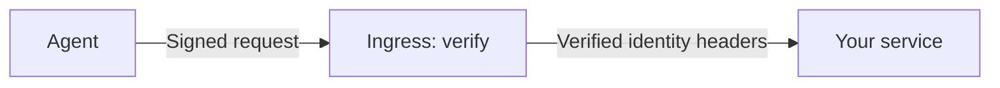
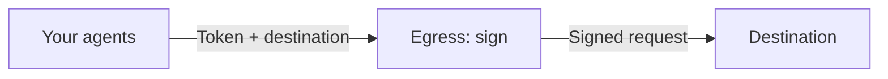

# Recipe 32 — DNSid ingress and egress on Cloudflare Workers

> Verify incoming agent requests and sign outgoing ones with two independent Workers.

**Spec version:** `dnsid-draft-01`

**Status:** runnable locally; Cloudflare deployment requires an account

**Standards used:** RFC 9421 (HTTP Message Signatures), RFC 7517 (JSON keys), RFC 9530 (body digests), C2SP tlog (transparency log)

**Estimated time:** ~15 minutes

## What you'll build

Two Workers you can use independently. Deploy either one, or use them together.

### Ingress · verify incoming requests



Ingress verifies the agent’s DNSid identity and request signature, rejects replays, and forwards the request to your configured origin. Your service decides what that agent may do.

### Egress · centralize outgoing signing



Egress gives an operator one place to hold agent signing keys and sign outgoing requests. Instead of loading a private key and integrating signing into each client, an agent sends its request to egress with a bearer token. Egress selects the corresponding identity, signs the request, and forwards it.

**When to use it:** when you want to manage signing keys centrally or keep signing logic out of individual clients. One Worker can serve multiple agent identities. Clients still need to protect their bearer tokens, and requests take an extra hop through the Worker.

**When to skip it:** when your agents already manage their keys and sign with the SDK. Ingress accepts valid DNSid signatures without requiring our egress Worker. Egress is optional tooling; whether it helps depends on how you operate your agents.

Both Workers return the destination’s response to the caller.

## Why this matters

HTTP signatures prove that a request came from a particular key. DNSid supplies the verifiable identity behind that key. This puts verification in front of an existing service without embedding DNSid logic in every route; the service still decides what the agent may do.

## Prerequisites

- Node.js 24+, npm, and `make`.
- Docker 24+, running.
- The `dnsid` CLI with second-level local identity support and custom local ports.
- A clone of this cookbook.

The SDK packages are pinned to 0.34.0. Wrangler and Miniflare, the local Worker runtime, are locked in `package-lock.json`. Local verification needs no Cloudflare account.

## Concepts

- **DNSid identity:** a domain with a signed DNS record, public keys, issuance evidence, and current status that a verifier checks together.
- **Accountable entity:** the entity bound to the agent's identity during issuance. It is forwarded alongside the agent domain.
- **Request signature:** proof covering parts of an HTTP request, including its method, destination, and body. A nonce is a one-use value that ingress records to reject repeated requests.
- **Origin:** the service ingress forwards to. It checks a shared secret before trusting identity headers and enforces its own access rules.

## Running system

| Process | Where | Role |
| --- | --- | --- |
| DNS, registry, log, HTTPS proxy | CLI-managed Docker containers, isolated state and free ports | Issue identities and serve real verification evidence |
| Egress and ingress | Miniflare on your machine | Run the actual Worker bundles |
| Test origin | Node HTTP server on a free loopback port | Check the origin secret, echo requests, return a fixed denial |

The harness routes Worker DNS and HTTPS calls to these local services. It uses the CLI-supplied `DNSID_LOG_POLICY_URL`, not a policy chosen by an incoming agent. It never resets your existing registry.

## Step 1 — Create local identities

From this recipe directory:

```sh
make bootstrap
```

This installs dependencies and provisions `enrolled.test`, `stranger.test`, and `revoked.test` using `dnsid local up --zone test` and `dnsid local agent ensure … -- dnsid log issue`. The last identity is revoked for the rejection test. Repeating bootstrap reuses this recipe's setup.

## Step 2 — Follow outgoing requests

[`src/egress.ts`](src/egress.ts) checks a bearer token, selects an agent key, signs the request, and forwards it. Multiple tokens may select one identity; one token cannot select two identities.

Callers provide `Authorization: Bearer <token>` and `DNSid-Destination: https://destination.example`. Egress requires an HTTPS destination and preserves the path and query. The local harness supplies disposable keys and tokens for you.

## Step 3 — Follow incoming requests

[`src/ingress.ts`](src/ingress.ts) verifies identity and signatures, rejects reused nonces, then forwards these headers:

- `DNSid-Agent`: verified agent domain.
- `DNSid-Accountable-Entity`: its accountable entity.
- `DNSid-Origin-Auth`: the secret your origin must check before trusting either identity header.

The Worker has no application access policy. The [test origin](test/e2e/origin.ts) simply echoes requests and supplies a fixed denial to demonstrate response forwarding.

## Run it

```sh
make run
```

This builds both Workers and runs the seven end-to-end scenarios. It prints each result, then closes the Workers and origin; the isolated registry stays available until `make clean`.

## Verify

```sh
make verify
make clean
```

Verification checks types, runs 32 fast tests, builds both Workers, and runs seven end-to-end tests. Success includes:

```text
✔ forwards verified identity on cold and warm requests
✔ rejects a revoked identity before contacting the origin
✔ preserves the signed method, path, query, and body
✔ rejects reuse of a signed request without contacting the origin again
```

The suite also checks unsigned requests, direct origin calls without the secret, and origin response forwarding. `make clean` stops only this recipe's registry and removes its temporary state. Standalone `npm run test:e2e` provisions and cleans up its own registry automatically. See [test details](test/README.md).

Local results do not establish Cloudflare edge behavior. Before production, resolve the log fetcher's DNS/address guarantees, the synthetic certificate-expiry workaround, and whether checkpoint history needs durable storage.

## What to try next

**Deploy independently.** Configure `ORIGIN_URL` and a trusted `DNSID_LOG_POLICY_URL` in `wrangler.ingress.jsonc`. Then set secrets and deploy whichever Worker you need:

```sh
npx wrangler login
npx wrangler secret put ORIGIN_SECRET -c wrangler.ingress.jsonc
npx wrangler deploy -c wrangler.ingress.jsonc

npx wrangler secret put DNSID_AGENTS -c wrangler.egress.jsonc
npx wrangler deploy -c wrangler.egress.jsonc
```

Your origin must validate the shared secret. For egress, assemble the Worker-specific agent configuration below; the CLI does not generate this JSON. Replace the placeholders with an issued identity, its private key, and hashes of strong random bearer tokens. Keep keys and tokens out of source control.

```json
{
  "agent.example": {
    "privateJwk": "<private JWK serialized as a JSON string>",
    "tokenHashes": ["<lowercase SHA-256 token hash>"]
  }
}
```

**Compare another integration.** [Recipe 12](../12-a2a-dnsid/) applies signed identities to agent-to-agent messaging. [Recipe 31](../31-langgraph-dnsid-agent/) integrates them into a LangGraph agent.
